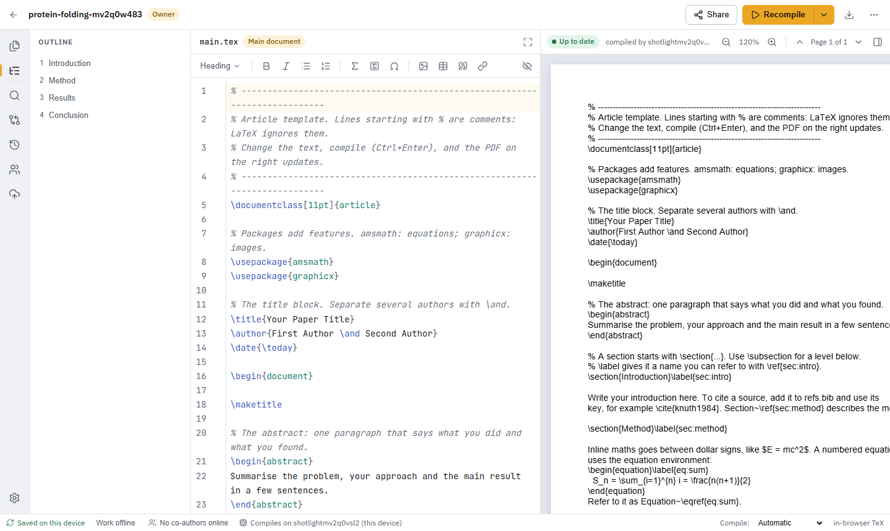
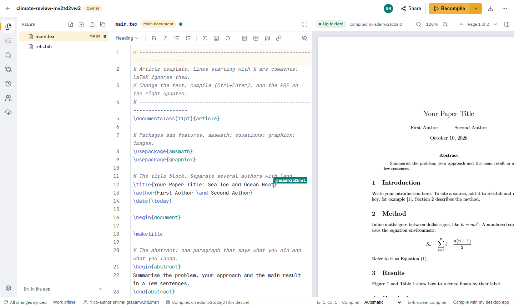
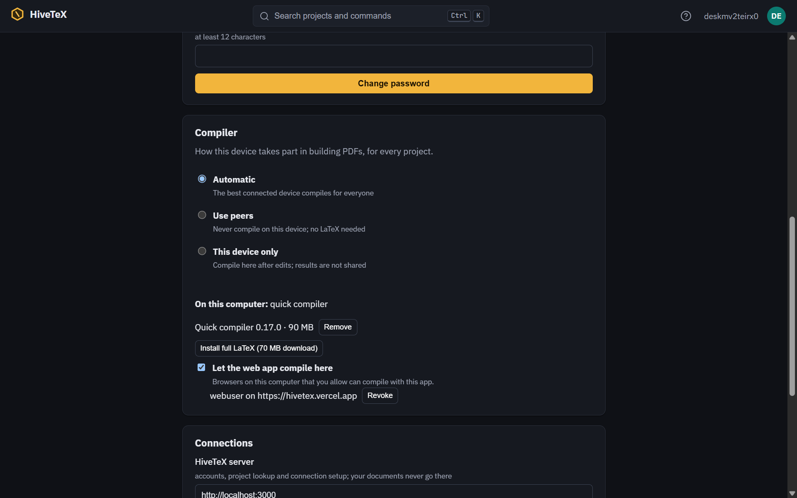
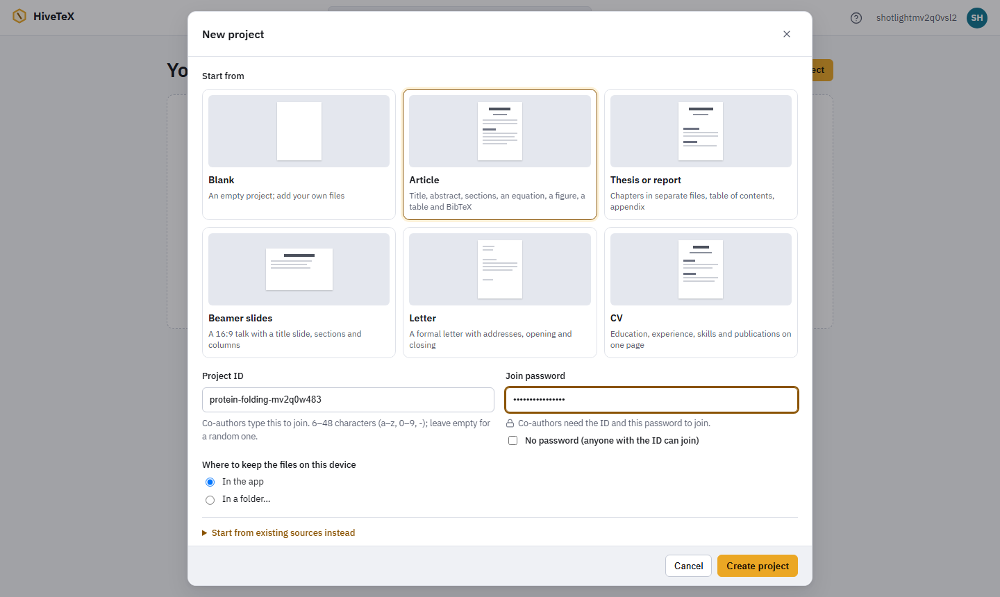
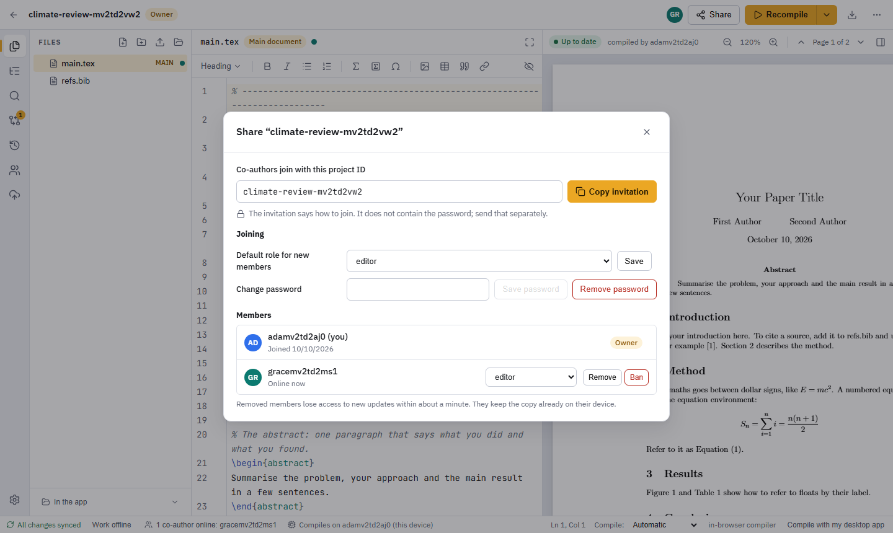
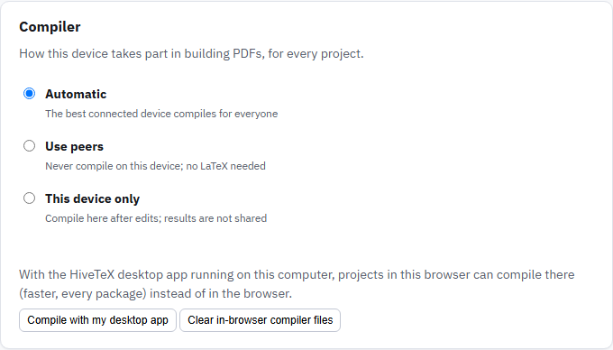

# HiveTeX

Free, peer-to-peer collaborative LaTeX editor. Your sources stay on the co-authors' devices, synced live between them,
and the best connected device compiles the PDF for everyone. A small server only handles accounts, finding projects,
permissions and setting up connections: your documents never go there.

Use it in the browser or as a desktop app (Windows, macOS, Linux). No LaTeX installation is needed.



- **Write together in real time:** each co-author has a color on avatars, cursors and files. You can *follow* a
  co-author, and the Changes view shows who changed what.
- **An IDE for papers:** templates that compile out of the box (article, thesis, Beamer, letter, CV), and a toolbar that
  writes LaTeX for you. Compile errors come in plain words with one-click fixes. There is also a command palette
  (Ctrl/Cmd+K), Vim or Emacs keys, SyncTeX both ways, and light and dark themes
  ([dark](docs/images/workspace-dark.png), [landing page](docs/images/landing.png)).
- **Your files, your tools:** a project can live in a folder on your computer, such as a git clone, so editors and AI
  tools (Claude Code, Codex, Cursor) work on the same files. Projects can be backed up to GitHub.
- **Compiling is shared:** whoever is best placed builds the PDF and sends it to the others. Each device can choose
  instead to compile only for itself, or never.



---

## Use HiveTeX

### In the browser

Open **https://hivetex.vercel.app**, create an account, and create a project from a template, or import one from
Overleaf, arXiv, a .zip or a folder.

The browser compiles with a built-in engine. If the HiveTeX desktop app is running on the same computer, choose
**Compile with my desktop app** (status bar, or *Account → Compiler*). The desktop app asks you to allow it, and from
then on that browser compiles there: faster, with every LaTeX package.

### The desktop app

Download the installer for your system from the [Releases page](https://github.com/federicocunico/HiveTeX/releases).
First launch:

- **Windows:** SmartScreen shows "Windows protected your PC". Click *More info* → *Run anyway*.
- **macOS:** open the `.dmg` and drag HiveTeX to Applications. If macOS blocks it, open *System Settings → Privacy &
  Security* and click *Open Anyway*.
- **Linux:** run `chmod +x HiveTeX_*.AppImage` and start it, or install the `.deb`. Device keys need a keychain (GNOME
  Keyring or KWallet), which standard desktops have.
- **Any OS:** the sign-in screen shows the server (`hivetex.vercel.app` by default). Use *Change* to connect to
  another one.
- **No account needed:** *Continue without an account* on the sign-in screen lets you write on this computer only,
  with nothing sent anywhere. Sign in later to share a project, or to merge it into one you join
  ([details](docs/offline.md)).

Installed apps check GitHub when they start. If a newer release exists, a badge says "Version X is available" with a
**Download** button that opens the release page (dismiss it and it stays away until a newer version appears). Running the
new Windows installer removes the old version first (setup or MSI), keeping your projects and settings. *Account →
Check for updates* still installs an update in place.

**Compiling on the desktop:**
- It uses your TeX installation (TeX Live, MiKTeX, MacTeX) if you have one.
- Otherwise it sets up a **quick compiler** (about 20 MB) at the first compile, and downloads packages as documents
  need them.
- **Full LaTeX** (TinyTeX) is one click away in *Account → Compiler*. Missing packages are then installed
  automatically during builds.

The same panel lists the browsers allowed to compile on this computer. See [Compilation](docs/compilation.md) for
details.



### Writing with others

1. Create a project: *New project*, pick a template, and choose a project ID and password.

   

2. Click **Share** and send co-authors the invitation (the project ID). Send the password separately. Choose the
   role new members get (viewer or editor), and manage members later in the same dialog.

   

3. Co-authors use **Join a project** with the ID and password. Everyone online edits live. While you're offline you
   keep editing, and the changes merge when you reconnect.
4. **Compiling:** by default the best connected device builds the PDF for everyone. In *Account → Compiler*, or in
   the status bar, each device can choose *Automatic*, *Use peers* (never compile here) or *This device only*.

   

5. **Use Claude Code (or another AI tool):** in the desktop app, right-click the **Files** panel → **Open in
   terminal** and run `claude`. A project kept in the app first gets its own folder in `Documents/HiveTeX`.
   Everything the tool changes there (edits, new files, deletes) shows up in HiveTeX at once and reaches your
   co-authors.

6. **Offline:** keep writing without a connection (or with *Work offline*). When co-authors connect again, your work
   is merged like git: changes in different places merge by themselves, and changes to the same lines are shown side
   by side for you to decide. See [Working offline](docs/offline.md).

More: [the interface and shortcuts](docs/interface.md) · [importing](docs/import.md) ·
[working offline](docs/offline.md) ·
[projects in folders](docs/folders.md) · [local AI tools](docs/local-ai-tools.md) ·
[GitHub backup](docs/github-backup.md) · [permissions](docs/permissions.md).

### Run it from the sources

You need Node 22 with pnpm 10 (`corepack enable`), Git and GNU Make. On Windows, run `make` from Git Bash and install
it with `scoop install make` or `choco install make`. You also need Rust for the desktop app. Then:

```bash
make install     # dependencies
make dev         # the desktop app with hot reload, connected to https://hivetex.vercel.app
make dev-local   # everything on your computer: API on :3000 (embedded database, emails printed to the console)
                 # and the web app on http://localhost:1420
```

- **`make dev` uses real accounts** on the hosted server. Add `SERVER=https://…` to connect to another server.
- **`make dev-local` is for throwaway testing:** nothing leaves your computer.

---

## Host your own server

HiveTeX's server runs on [Vercel](https://vercel.com) (Hobby plan, free), with [Neon](https://neon.tech) (Postgres)
and [Upstash](https://upstash.com) (Redis) from the Vercel marketplace. You need accounts on GitHub and Vercel, and a
Gmail address used only to send email. Vercel Hobby is for non-commercial use. To run everything on your own
machines instead, see [the Docker stack](docs/local-stack.md) and [Deployment](docs/deployment.md).

Run the commands from the repository root (Git Bash on Windows).

1. **Install the tools:** Node 22 with pnpm, Git, GNU Make and the [GitHub CLI](https://cli.github.com). Then run
   `make install`.

2. **Get a Gmail App Password** at [myaccount.google.com/apppasswords](https://myaccount.google.com/apppasswords)
   (2-step verification is required). The server uses it to send verification and password-reset emails.

3. **Run the setup.** It does the following:
   - logs you in to GitHub and Vercel if needed, and links the Vercel project;
   - adds Neon and Upstash, and stores all server secrets;
   - deploys (the database tables are created during the build) and checks `/api/health`;
   - configures GitHub so desktop installers point at your server.

   It asks for your Gmail address, the App Password and the username that becomes admin, plus optional Cloudflare
   TURN keys for testers on difficult networks (leave them empty to skip).

   ```bash
   make setup              # preview first with: make setup DRY_RUN=1
   ```

   - **Without questions:** put the answers in `.env.setup` (git-ignored; the keys are listed at the end of
     `.env.example`).
   - **Re-running is safe:** existing secrets are kept and the app is redeployed.
   - **TURN:** testers on different networks connect more reliably with a free
     [Cloudflare Realtime TURN](https://developers.cloudflare.com/realtime/turn/) key (`CF_TURN_KEY_ID`,
     `CF_TURN_API_TOKEN`).

4. **Become admin:** open the URL printed at the end and register the admin username you gave. It becomes the
   platform admin automatically, but only while no admin exists yet.

5. **Build the desktop installers.** Set the version everywhere and commit it (`make version VERSION=0.1.2`), then
   push the release tag:

   ```bash
   make release VERSION=0.1.2 CONFIRM=1   # checks CI passed for this commit, then pushes tag v0.1.2
   ```

   After about 30 minutes the release is **published** on the Releases page with the Windows, macOS and Linux
   installers, already pointing at your server, and installed apps are offered the update. A failed build is re-run
   automatically (3 attempts); after that the release stays a draft until you re-run the failed job (see [Deployment](docs/deployment.md#5-desktop)).

6. **Invite people:** send them your web link, or the release page for the desktop app.

## Keep your deployment up to date

The web app and the server are deployed together. Database migrations run in the Vercel build, so every deploy also
brings the schema up to date, and a failing migration fails the deploy. Pick one of these:

- **Automatically, on every push to `master`:** connect the Vercel project to your GitHub repository (Vercel dashboard
  → your project → *Settings → Git*). Each push then deploys to production, and `npx vercel ls` lists the
  deployments. This is how https://hivetex.vercel.app is kept current.
- **By hand, after checks:** `make deploy-prod CONFIRM=1` runs everything CI runs (`make check`), then deploys to
  production.
- **By hand, with the setup:** re-run `make setup`. It redeploys and checks `/api/health`, and changes nothing that's
  already configured.

Then check the deployment:

```bash
curl https://<your-app>.vercel.app/api/health            # {"ok":true}
npx vercel@latest logs <your-app>.vercel.app             # server errors
```

- **Desktop apps don't update with the server:** publish a new release (step 5) and users get it from *Account →
  Check for updates*. Releases built earlier keep working with an updated server.
- **Signing keys:** `make secrets` stores only the signing keys (`ROTATE=1` replaces the ticket keys).
- **More:** key rotation, the free-tier budget and manual setup are in [Deployment](docs/deployment.md).

---

## Development

Every target is a thin wrapper; the plain command is shown next to it.

| Make | Plain command | What it does |
|---|---|---|
| `make` | | list all targets |
| `make install` | `pnpm install` | install dependencies |
| `make dev` | `HIVETEX_SERVER=https://hivetex.vercel.app pnpm --filter @hivetex/desktop tauri dev` | desktop app with hot reload against the hosted server (`SERVER=https://…` for another one) |
| `make dev-local` | `pnpm turbo run dev --filter=@hivetex/server --filter=@hivetex/web` | everything local: API on :3000 (embedded Postgres, console mailer) + web on :1420 |
| `make test` | `pnpm turbo run test` | unit and integration tests of every package |
| `make e2e` | `pnpm exec playwright test` | end-to-end tests (starts a local API with an embedded database) |
| `make check` | build, lint, svelte-check, tests, bundle and CSP checks, e2e | what CI runs |
| `make up` / `make down` / `make reset` | `docker compose up -d --build --wait` … | full local stack with the production code path ([docs/local-stack.md](docs/local-stack.md)) |
| `make test-stack` | | e2e suite against the Docker stack |
| `make desktop-dev` / `make desktop-test` | `pnpm --filter @hivetex/desktop tauri dev` / `cargo test --lib` | desktop app (the Rust tests compile real LaTeX when a TeX distribution is installed) |
| `make desktop-e2e` | `node apps/desktop/e2e/run.mjs` | desktop UI tests over WebDriver (`tauri-driver`; see [docs/folders.md](docs/folders.md#desktop-ui-tests)); `HIVETEX_WINDOW=1024x768` for the narrow layout |
| `make deploy-preview` / `make deploy-prod CONFIRM=1` | `npx vercel deploy [--prod]` | deploy to Vercel ([docs/deployment.md](docs/deployment.md)) |

The screenshots in this README come from the app itself:
- **Web:** `SCREENSHOTS=1 pnpm exec playwright test e2e/screenshots.spec.ts` (with a running `make dev-local` API, or
  let Playwright start it).
- **Desktop:** `SCREENSHOTS=1 make desktop-e2e`.

### Architecture

- `apps/web`: Svelte 5 + Vite single-page app (also the desktop app's interface)
- `apps/desktop`: Tauri 2 shell (native compile, managed compilers, folder mirror, keychain, local compile helper)
- `server/`: the server (Hono, Drizzle, Neon Postgres, Upstash Redis); `api/index.ts` is its Vercel Functions entry
- `packages/*`: protocol, crypto, sync, compile, github, ui

**Documentation:**
- [The interface](docs/interface.md) · [Compilation](docs/compilation.md) · [Real-time performance](docs/performance.md)
- [Deployment](docs/deployment.md) · [Accounts & admin](docs/accounts.md) · [Permissions](docs/permissions.md)
- [Wire protocol](docs/protocol.md) · [Security review](docs/security.md) · [Local stack (Docker)](docs/local-stack.md)

Behavior specs are in `openspec/specs/`; proposals, designs and tasks are in `openspec/changes/archive/`.

## License

AGPL-3.0-or-later. If you run a modified public deployment, you must offer its source to its users (the web app links to
this repository). Vercel Hobby is for non-commercial use only.
